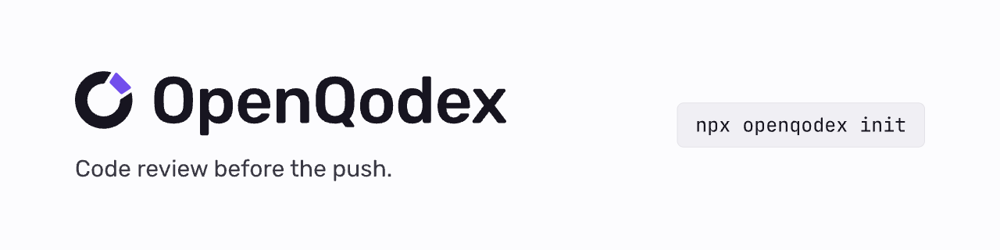
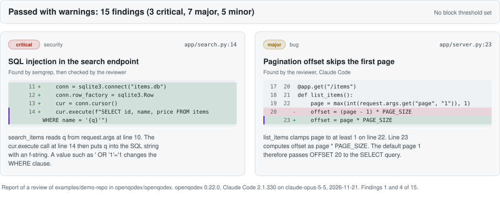
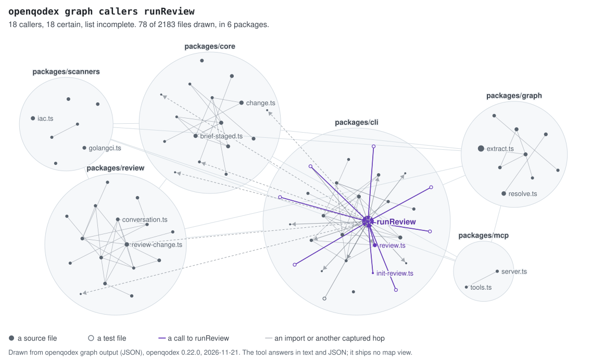
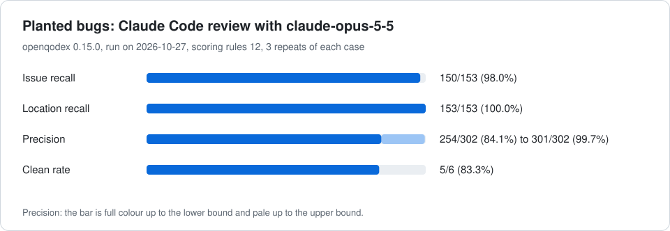
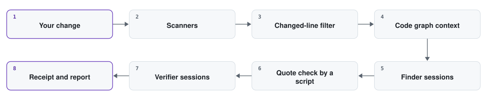

<picture>
  <source media="(prefers-color-scheme: dark)" srcset="https://raw.githubusercontent.com/openqodex/openqodex/main/.github/assets/readme-banner-dark.png">
  
</picture>

# OpenQodex

[](https://www.npmjs.com/package/openqodex)
[](https://github.com/openqodex/openqodex/blob/main/LICENSE)
[](https://github.com/openqodex/openqodex/actions/workflows/ci.yml)
[](https://github.com/openqodex/openqodex/discussions)

Open source code review that runs inside your coding agent, before you push. A separate reviewer checks every change your agent writes. A code graph gives your agent a map of your codebase. Works in Claude Code, Codex, Cursor, Cline and Goose.

## Install

```
npx openqodex init
```

Then say to your agent: "review my change with openqodex". `init` finds the agents on your machine, lists the files it will write and the reviewers it plans for your team, and asks you. In your own terminal, run `~/.openqodex/bin/openqodex review`. An `npx` install puts no `openqodex` on your `PATH`.

For agents, the same install with no question:

```
npx -y openqodex@0.26.0 init --yes --agent <host>
```

`<host>` is `claude-code`, `codex`, `cursor`, `cline` or `goose`. In its default sandbox, Codex gives commands no network, so run this line in your own terminal. The [quickstart](https://github.com/openqodex/openqodex/blob/main/docs/quickstart.md) has a prompt to paste into your agent. AI agents: read the [agent guide](https://github.com/openqodex/openqodex/blob/main/docs/for-agents.md).

<picture>
  <source media="(prefers-color-scheme: dark)" srcset="https://raw.githubusercontent.com/openqodex/openqodex/main/.github/assets/review-dark.svg">
  
</picture>

A review of the demo repository with openqodex 0.22.0, on 2026-11-21. The reviewer was Claude Code 2.1.330 with claude-opus-5-5.

[Website](https://openqodex.com) · [Docs](https://github.com/openqodex/openqodex/blob/main/docs/index.md) · [Benchmark](https://github.com/openqodex/openqodex/blob/main/docs/benchmark-results.md) · [Changelog](https://github.com/openqodex/openqodex/blob/main/packages/cli/CHANGELOG.md) · [Discussions](https://github.com/openqodex/openqodex/discussions)

Looking for hosted pull request review? [Sign up for Qodex](https://agents.qodex.ai/login/pr-review?utm_source=openqodex&utm_medium=readme&utm_campaign=readme-hosted).

## What you get: a review before every push

- `openqodex review` reviews your change in one command. Your change is the commits you have not pushed plus everything uncommitted.
- It runs the scanners that fit the files you changed, and keeps their findings on the lines you changed. A scanner is a program that checks code without a model, such as gitleaks or semgrep.
- Every supported lockfile in the repository is checked against osv.dev at every review and scan of a change. Advisories outside the changed lines are shown, never counted.
- Fresh reviewers check the change: separate Claude Code or Codex processes on your own login, with no memory of your session.
- A script checks every line a reviewer quotes as evidence against the code. Verifiers confirm or refute every candidate and every scanner finding.
- At the end, it prints a receipt: the verdict, one line per finding and the path of `report.html`. It also writes `report.md`, `report.json` and `report.sarif`. Here is an [example report](https://github.com/openqodex/openqodex/blob/main/tests/golden/expected/claude/run/report.md).
- You choose what gets fixed. Your agent asks "Fix all, or tell me which?" and fixes only the findings you name.
- The push gate warns by default. It blocks only when `.openqodex/config.yaml` sets `review.block_on_severity`.
- It runs only in repositories you opt in. A repository opts in with `.openqodex/config.yaml`, which `openqodex init` writes there. Elsewhere your agents do not review before a push, and the push gate says nothing.

## What you get: a code graph

<picture>
  <source media="(prefers-color-scheme: dark)" srcset="https://raw.githubusercontent.com/openqodex/openqodex/main/.github/assets/graph-dark.svg">
  
</picture>

A picture drawn from real `openqodex graph` output on this repository, on 2026-11-21. The tool answers in text and JSON. It has no graph viewer.

- The graph maps every function, class and type, and every call and import between them. It is built on your machine, with no model.
- A review gives the reviewer what your change reaches in the graph: callers, callees, uses and importers.
- Languages: TypeScript, TSX, JavaScript, Python, Go, Ruby and Java. Framework readers: Express, Hono, Nest, React, Next.js, FastAPI, Go net/http, gin, Django, Rails and JUnit. They add routes and tests.
- You or your agent can ask it questions, such as who calls a function, what a change could affect, or which tests reach it. The [code graph page](https://github.com/openqodex/openqodex/blob/main/docs/graph.md) lists every question.
  ```
  npx openqodex graph callers <name>
  npx openqodex graph impact <name>
  npx openqodex graph tests <name>
  ```
- An MCP server is a local tool server that your agent starts. `init` gives your agent the graph questions through one. For the Cline VS Code extension and for Goose, `init` prints the entry for you to add.
- Every answer says when it may be incomplete, and why. Zero callers on such an answer never means unused.

## Where it runs

| Coding agent | Starts a review | Can be the reviewer | Push gate |
|---|---|---|---|
| Claude Code | yes | yes | yes |
| Codex CLI | yes | yes | yes, after you trust the hook in Codex |
| Cursor | yes | no | no, a rule asks Cursor to review |
| Cline | yes | no | no, a rule asks Cline to review |
| Goose | yes | no | no, the hints ask Goose to review |

In Cursor, Cline and Goose, the review needs Claude Code or Codex installed as the reviewer. Each project picks its reviewers, in order, with a model for each, in `.openqodex/config.yaml`: when one hits a usage limit, the review starts again with the next ([configuration](https://github.com/openqodex/openqodex/blob/main/docs/config.md#reviewers)). A push gate is a hook that looks for a review before your agent runs `git push`. [What init writes for each agent](https://github.com/openqodex/openqodex/blob/main/docs/agents.md) says how each gate works.

<!-- benchmark-results:start -->
## Benchmark

<picture>
  <source media="(prefers-color-scheme: dark)" srcset="https://raw.githubusercontent.com/openqodex/openqodex/main/.github/assets/benchmark-dark.svg">
  
</picture>

The chart shows one accepted run: Claude Code with claude-opus-5-5 on openqodex 0.15.0, run on 2026-10-27. Each number adds up 3 repeats of every case, and repeats of one case can give different results. The table shows selected accepted runs. [The full results](https://github.com/openqodex/openqodex/blob/main/docs/benchmark-results.md) list every accepted run.

| Reviewer | Model | Cases | Issue recall | Precision | Clean rate | Cost per review | openqodex | Run date |
| --- | --- | --- | --- | --- | --- | --- | --- | --- |
| Claude Code (claude-graph-on) | claude-opus-5-5 | Planted bugs, dev split, scoring rules 11 | 150/153 (98.0%) | 249/295 (84.4%) to 295/295 (100.0%) | 6/6 (100.0%) | $0.4371 | 0.15.0 | 2026-10-27 |
| Claude Code (claude-graph-on) | claude-opus-5-5 | Planted bugs, dev split, scoring rules 12 | 150/153 (98.0%) | 254/302 (84.1%) to 301/302 (99.7%) | 5/6 (83.3%) | $0.4248 | 0.15.0 | 2026-10-27 |
| Claude Code (claude-graph-on) | claude-opus-5-5 | Planted bugs, dev split, scoring rules 7 | 129/153 (84.3%) | 142/146 (97.3%) to 146/146 (100.0%) | 6/6 (100.0%) | $0.0870 | 0.12.0 | 2026-10-12 |
| Codex (codex-graph-on) | gpt-6.1-sol | Planted bugs, dev split, scoring rules 7 | 115/153 (75.2%) | 125/146 (85.6%) to 146/146 (100.0%) | 6/6 (100.0%) | not measured | 0.12.0 | 2026-10-12 |
| Scanner only (scan) | no model | Planted bugs, dev split, scoring rules 1 | 32/51 (62.7%) | 35/45 (77.8%) to 40/45 (88.9%) | 1/2 (50.0%) | not measured | 0.12.0 | 2026-10-11 |
| Scanner only (scan) | no model | Planted bugs, dev split, scoring rules 2 | 32/51 (62.7%) | 36/41 (87.8%) to 41/41 (100.0%) | 2/2 (100.0%) | not measured | 0.19.0 | 2026-11-17 |

AACR-Bench is a set of real pull requests. Its own evaluator gives the board numbers below.

| Reviewer | Model | Cases | Issue recall | Semantic precision | Semantic recall | Semantic F1 | Noise rate | Line precision | Line recall | Cost per review | openqodex | Run date |
| --- | --- | --- | --- | --- | --- | --- | --- | --- | --- | --- | --- | --- |
| Library (model-gpt-6.1-sol-graph-on) | gpt-6.1-sol | AACR-Bench, dev split, dev-laptop subset, scoring rules 7 | not yet ruled | 22.8% | 5.2% | 8.5% | 77.2% | 49.4% | 11.3% | $0.0839 | 0.12.0 | 2026-10-12 |

[Full results and how to read them](https://github.com/openqodex/openqodex/blob/main/docs/benchmark-results.md)
<!-- benchmark-results:end -->

## How it works

<picture>
  <source media="(prefers-color-scheme: dark)" srcset="https://raw.githubusercontent.com/openqodex/openqodex/main/.github/assets/pipeline-dark.svg">
  
</picture>

1. Scanners run on the files you changed. OpenQodex drops findings off the changed lines, in test fixtures and in rules you switched off.
2. The code graph gives each part of the change the code that calls it and the code it calls.
3. Finder sessions read each part of the change and propose candidates, each with a quoted line as evidence.
4. A script checks every quote against the code. Verifier sessions then confirm or refute each candidate and each scanner finding, with a reason.
5. Scripts check that every scanner finding was answered and every changed line was given to a reviewer. Then the receipt and the report are written.

## Privacy

The built-in scanners, as OpenQodex runs them, send no code. OpenQodex starts semgrep with its metrics switched off. The reviewer sends your change to the model service of your Claude Code or Codex login.

`--offline` skips semgrep, osv-scanner, kubeconform and cargo-deny, the built-in scanners that use the network. It also stops scanner downloads. The reviewer still sends your change to its model service. An approved custom scanner still runs its own command. The [privacy page](https://github.com/openqodex/openqodex/blob/main/docs/privacy.md) lists each network use of this version. The [telemetry page](https://github.com/openqodex/openqodex/blob/main/docs/telemetry.md) says more.

OpenQodex sends anonymous usage data, never code. `openqodex_telemetry: 0` in `.openqodex/config.yaml`, `OPENQODEX_TELEMETRY=0` or `DO_NOT_TRACK=1` turns it off ([details](https://github.com/openqodex/openqodex/blob/main/docs/telemetry.md)).

## Built-in scanners

OpenQodex has 22 built-in scanners. Most scanners run when your change holds a file they read. Some also read the project or folder around a changed file. Each scanner that needs a download gets it on first use, pinned to one version.

| What it checks | Built-in scanners |
|---|---|
| Secrets in code | 1 |
| Security problems in code | 3 |
| Dependencies with known vulnerabilities | 2 |
| Lint | 5 |
| GitHub Actions workflows | 2 |
| Dockerfiles, Terraform, Kubernetes and CloudFormation | 6 |
| SQL and database migrations | 3 |

The [scanner list](https://github.com/openqodex/openqodex/blob/main/docs/scanners.md) gives each scanner, its version, the files it reads and what it does not check.

You or your agent can also add a compatible scanner by its GitHub link in `.openqodex/config.yaml`. It must write SARIF, or one JSON document that a `map` block turns into findings. `npx openqodex trust` shows what will run and asks you yes or no. OpenQodex runs it only after that approval. The [custom scanner guide](https://github.com/openqodex/openqodex/blob/main/docs/custom-scanners.md) explains every key.

## What it does not do yet

- No reviewer other than Claude Code or Codex. Cursor cannot be the reviewer. `cursor-agent` 2025.09.18 offered no way to limit it to reading.
- Without a reviewer, `review` prints "Full review unavailable" and exits 2. It saves the scanner findings, unchecked, to `unchecked-candidates.json`. It also names a fallback command, `review --agent`. In that fallback, your coding agent reviews its own change.
- Inside the Codex sandbox, a second Codex process does not start. So Codex cannot be the reviewer there. OpenQodex tested this with codex-cli 0.160.0 on macOS.
- No review on your own API key, except in the GitHub Action.
- No Homebrew formula, no install script and no Docker image in this version. Install through npm.
- No offline copy of the vulnerability databases. osv-scanner checks every lockfile through osv.dev. cargo-deny downloads the RustSec advisory database.
- No review finds every problem. The report names each stage that did not run.

## Open source and hosted

OpenQodex is free and open source under Apache 2.0. It runs on your machine, on your own Claude Code or Codex login, with no account and no key of its own. Nothing that is open today becomes paid later.

[Qodex](https://qodex.ai?utm_source=openqodex&utm_medium=readme) makes OpenQodex. Looking for hosted pull request review? [Sign up for Qodex](https://agents.qodex.ai/login/pr-review?utm_source=openqodex&utm_medium=readme&utm_campaign=readme-hosted).

[](https://qodex.ai?utm_source=openqodex&utm_medium=readme)

## Requirements

- Node 22 or newer, and git.
- macOS or Linux, or FreeBSD 15 or later on amd64 or on arm64. CI runs the gate on Node 22, on macOS and on Ubuntu Linux. No test runs on Windows or WSL, and the gate does not run on FreeBSD yet.
- For a full review: Claude Code or Codex, installed and logged in. OpenQodex needs no account or API key of its own.
- Some scanners need a language runtime that OpenQodex does not install. brakeman and rubocop need Ruby. golangci-lint needs Go. cargo-deny needs Cargo.

## Documentation

The docs ship inside the package. `npx openqodex guide <topic>` prints one page in your terminal.

- [Quickstart](https://github.com/openqodex/openqodex/blob/main/docs/quickstart.md), [agent guide](https://github.com/openqodex/openqodex/blob/main/docs/for-agents.md) and [commands](https://github.com/openqodex/openqodex/blob/main/docs/cli.md)
- [Configuration](https://github.com/openqodex/openqodex/blob/main/docs/config.md) and [what init writes for each agent](https://github.com/openqodex/openqodex/blob/main/docs/agents.md)
- [GitHub Action](https://github.com/openqodex/openqodex/blob/main/docs/github-action.md), [Node library](https://github.com/openqodex/openqodex/blob/main/docs/library.md) and [security](https://github.com/openqodex/openqodex/blob/main/docs/security.md)
- [All pages](https://github.com/openqodex/openqodex/blob/main/docs/index.md)

## Status, security and licence

OpenQodex is on the way to 1.0. Commands, flags and the configuration file can change between minor releases. The [changelog](https://github.com/openqodex/openqodex/blob/main/packages/cli/CHANGELOG.md) lists the changes in each release.

Report a vulnerability through GitHub's private vulnerability reporting, as the [security policy](https://github.com/openqodex/openqodex/blob/main/SECURITY.md) says. Never open a public issue for one. Licensed under [Apache 2.0](https://github.com/openqodex/openqodex/blob/main/LICENSE). The [NOTICE](https://github.com/openqodex/openqodex/blob/main/NOTICE) file gives the scanners' licences.
